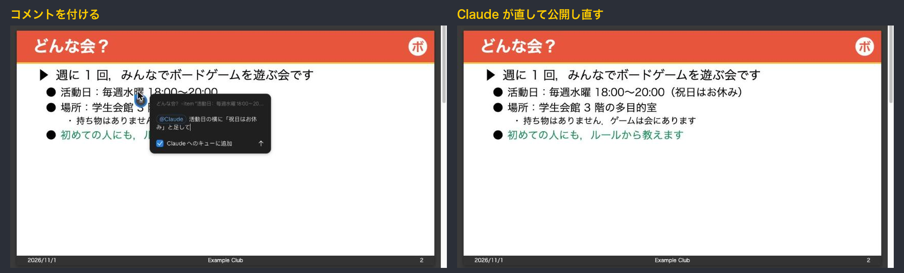
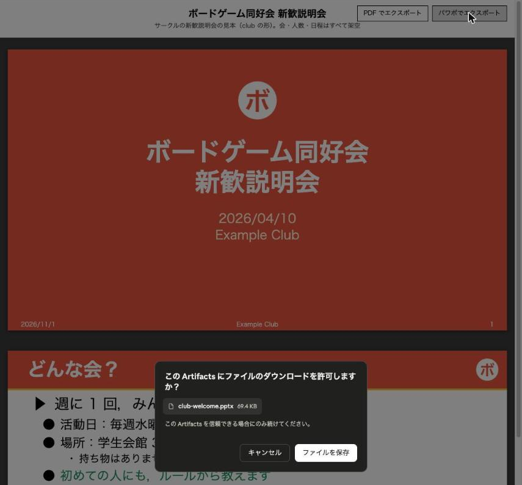

# master-slide-fmt

master-slide-fmt は、自分のパワポのマスター（.pptx）の体裁でスライドを作る Claude Code のスキルです。


## 主な機能

| 機能 | 説明 |
|---|---|
| マスターの体裁の読み取り | 大きさ（4:3・16:9）、タイトルの位置と色、本文の書体と段、飾り、背景、脚注をマスターから読み取ります |
| HTML・PDF・PPTX の作成 | 1 つの原稿から、プレビュー用の HTML、PDF、PPTX を作ります |
| 編集できる PPTX | 文はテキスト、表は表、式は PowerPoint の数式として、マスターの上に置きます |
| 用途ごとの形の切り替え | 研究室・サークル・会社など、形ごとのマスターと設定を「プロファイル」にまとめ、作業しているフォルダから選びます |
| コメントでの修正 | 公開したページにコメントを付けると、Claude が直して公開し直します |

## インストール方法

```bash
git clone https://github.com/asterisk3157/master-slide-fmt ~/.claude/skills/master-slide-fmt
python3 ~/.claude/skills/master-slide-fmt/tools/doctor.py
```

`doctor.py` が依存の表を出します。uv と Chrome が「ある」になっていれば使えます。

## 使い方

1. **エージェントとの対話**:Claude Code に「このマスターで、サークルの新歓のスライドを作って」のように頼みます。Claude が聞き手・時間・構成を確かめながら原稿を書きます。
2. **Artifact へのコメント**:Claude が HTML を Artifact（claude.ai のページ）で公開します。直したい枚・図・言葉にコメントを付けると、Claude が直して公開し直し、スレッドに返信します。
   
3. **PDF・PPTX のダウンロード**:仕上がったら、Artifact の右上の「PDF でエクスポート」「パワポでエクスポート」から保存します。保存の確認が出たら「ファイルを保存」を押します。資料のフォルダにも同じ PDF と PPTX ができています。
   

### 補足

<details>
<summary>見本のプロファイル（10 種類）</summary>

テーマ・数値・文献・名前は、すべて架空です。

| プロファイル | 大きさ | 用途 | 形 |
|---|---|---|---|
| `research-lab` | 16:9 | 研究室のゼミ・報告 | 左端に紺の縦の帯、左寄せの見出しの下に細い線、表紙は紺の背景 |
| `seminar-4x3` | 4:3 | 勉強会・講義 | 白地に左寄せの紺の見出しと色の線、表紙は左端に色の縦の帯 |
| `club` | 16:9 | サークル・イベント | 上に色の帯（タイトルは白）、右上にロゴの画像、表紙は色の背景 |
| `lt-dark` | 16:9 | LT・技術発表 | 暗い背景に白い文字、見出しの下に短い水色の線 |
| `conference-16x9` | 16:9 | 学会・研究会の口頭発表 | 上端に細い緑の帯、下に学会名の入った脚注の帯 |
| `minimal-16x9` | 16:9 | 社内の報告・定例 | 飾りなし、細めの見出し、右下にページ番号だけ |
| `travel` | 16:9 | 旅行のしおり・案内 | クリーム色の背景、見出しの下に丸い飾り、表紙に大小の円 |
| `pitch` | 16:9 | 製品の紹介・ピッチ | 白地に大きな見出し、ページ番号は紫の丸の中、表紙は紫の背景 |
| `notice-4x3` | 4:3 | 地域のお知らせ・掲示 | 上に緑の帯（見出しは白・中央）、表紙は緑の角丸の枠 |
| `plain-16x9` | 16:9 | 出発点 | 素の Office テーマ。設定はすべてマスターから読みます |

各プロファイルには、言い回し・見出し・色の付け方の決まりを書いた `STYLE.md` があり、Claude は資料を書く前にこれを読みます。同じ原稿を 4 つのプロファイルで作ると、次のようになります。


</details>

<details>
<summary>見本の資料（11 本）</summary>

#### 研究・勉強・技術の資料

| 資料 | プロファイル | 中身 |
|---|---|---|
| `research` | research-lab | ダミーの研究「プロンプトの長さとハルシネーションの起こりやすさ」 |
| `seminar-bayes` | seminar-4x3 | 勉強会「ベイズの定理の入門」 |
| `conference-co2` | conference-16x9 | 学会発表「室内の CO2 濃度を推定する手法」 |
| `lt-build` | lt-dark | LT「CI のビルド時間を半分にした話」 |
| `parts` | research-lab | 書ける部品の見本（1 枚に 1 つ） |


#### それ以外の資料

| 資料 | プロファイル | 中身 |
|---|---|---|
| `club-welcome` | club | ボードゲーム同好会の新歓説明会 |
| `travel-kyoto` | travel | 旅行のしおり「秋の京都 1 泊 2 日」 |
| `pitch-wallet` | pitch | 家計簿アプリの紹介 |
| `festival-notice` | notice-4x3 | 町内の夏祭りのお知らせ |
| `monthly-report` | minimal-16x9 | 社内の月次報告「会議室の利用状況」 |
| `self-intro` | minimal-16x9 | 新しいチームでの自己紹介 |


原稿は `examples/decks/<名前>/<名前>.src.html` です。

</details>

<details>
<summary>PDF と PPTX の見た目</summary>

PDF は 1 枚 1 ページです。PPTX はマスターの上に置き直してあり、文・表・式を編集できます。分数や Σ の上下がある式は、PowerPoint の数式になります。

| PDF | PPTX（LibreOffice で表示） |
|---|---|
|  |  |

LibreOffice・Keynote・Google スライドは PowerPoint の数式を描けないため、一緒に入れてある式の画像が出ます。

</details>

<details>
<summary>自分のマスターからプロファイルを作る</summary>

Claude に「このマスターでプロファイルを作って」と頼むと作ります。置き場は `~/.config/master-slide-fmt/profiles/<名前>/` で、どのリポジトリの外にもあるため、名前や所属の入ったマスターを置いても公開されません。

`profile.json` の `private_words` に公開したくない語（名前、学籍番号、所属など）を書いておくと、`tools/check_public.py` が公開するファイルの中を探して知らせます。フォークして公開する前に実行します。

</details>

<details>
<summary>手で build する（Claude を使わない場合）</summary>

```bash
S=~/.claude/skills/master-slide-fmt
python3 $S/tools/profile.py new my-club --master $S/examples/club/master.pptx --match '~/club/**'
python3 $S/tools/new_deck.py ~/club/slides/2026-04-10_welcome --title 新歓説明会
cd ~/club/slides/2026-04-10_welcome && ./build.sh
```

2 行目でプロファイルを、3 行目で資料のフォルダを作ります。`examples/decks/parts/parts.src.html` を参考に原稿（`*.src.html`）を書いて最後の行を実行すると、HTML・PDF・PPTX と、全部の枚を並べた確認用の画像（`.build/*.sheet.png`）ができます。

</details>

<details>
<summary>Claude 以外のエージェントで使う場合</summary>

プロファイル・build・PDF・PPTX は、どのエージェントでも動きます（`SKILL.md` は Codex などからも読めます）。Artifact にコメントを付けて直す流れは Claude の機能を使うため、Claude 専用です。ほかのエージェントでは、build した PDF を見て、直す所をチャットで伝えます。

</details>

## うまく動かないときは

<details>
<summary>依存が足りないときに外れる機能</summary>

| 依存 | 無いとき |
|---|---|
| [uv](https://docs.astral.sh/uv/) | 動きません（必須） |
| Google Chrome / Chromium | HTML だけを作ります |
| LaTeX（latex・dvisvgm） | HTML の式は MathJax で表示します |
| [pandoc](https://pandoc.org/) | PPTX の式は画像になります |
| LibreOffice か PowerPoint | PPTX の確認用の画像を作れません |

</details>

<details>
<summary>build の出力に「はみ出し」「画像にした式」が出た</summary>

「はみ出し: n 枚目」は、文や図がスライドに入りきらなかった枚です。枚を分けるか、文を短くします。「画像にした式」は、PowerPoint の数式に変換できなかった式で、理由が一緒に出ます。

</details>

## ドキュメント

- Claude が読む手順と設定の一覧:[SKILL.md](SKILL.md)
- 原稿に書ける部品:[examples/decks/parts/parts.src.html](examples/decks/parts/parts.src.html)
- 自分のプロファイルの置き場:[profiles/README.md](profiles/README.md)

## ライセンス

準備中です。
