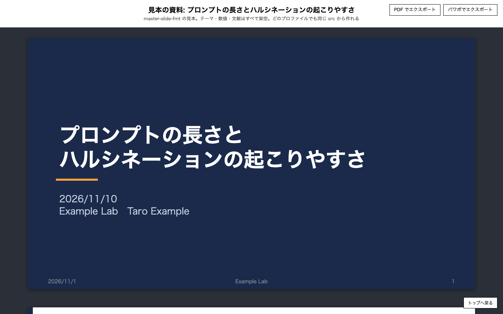
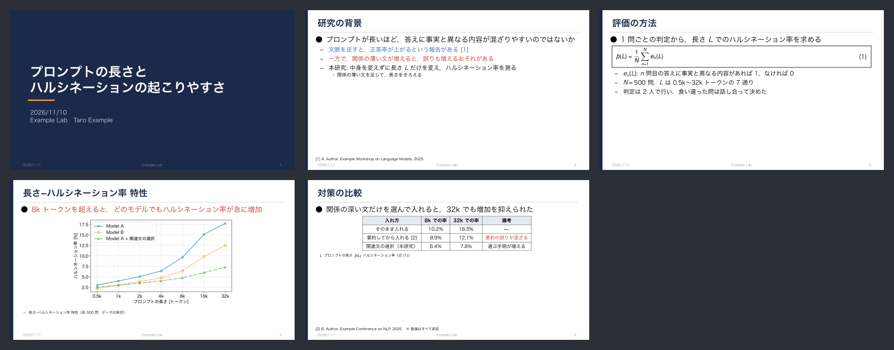
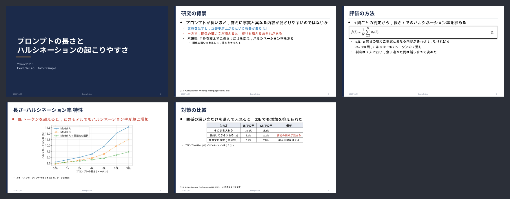
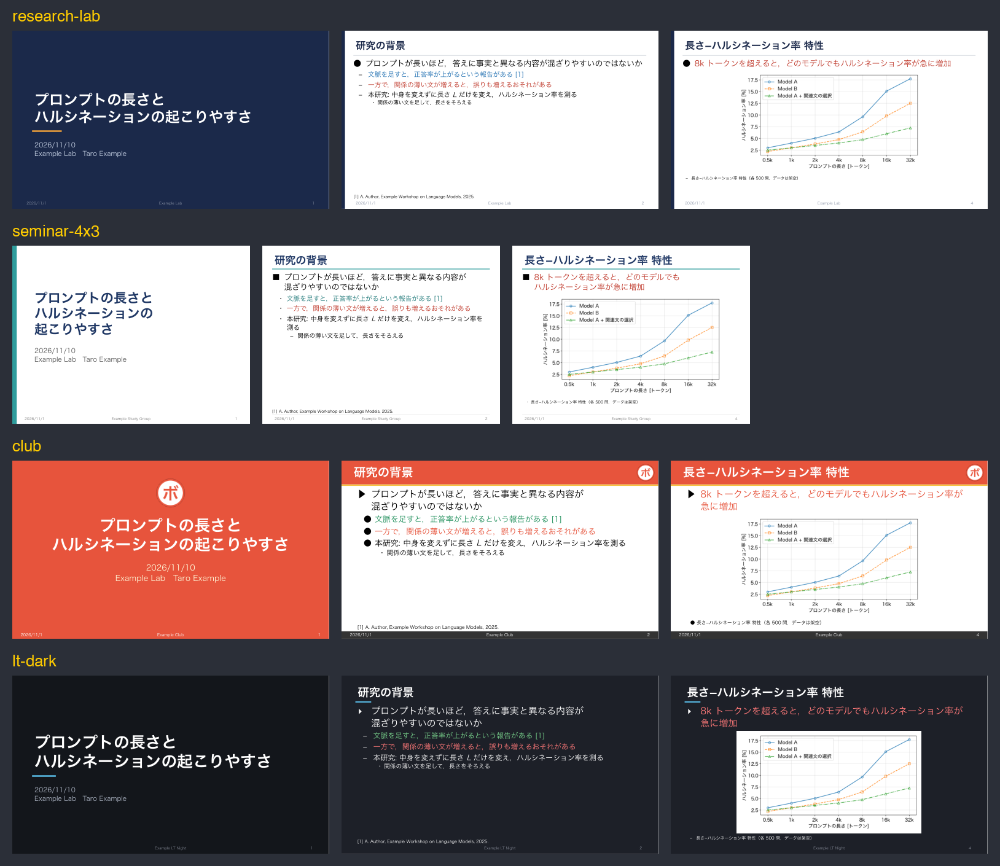
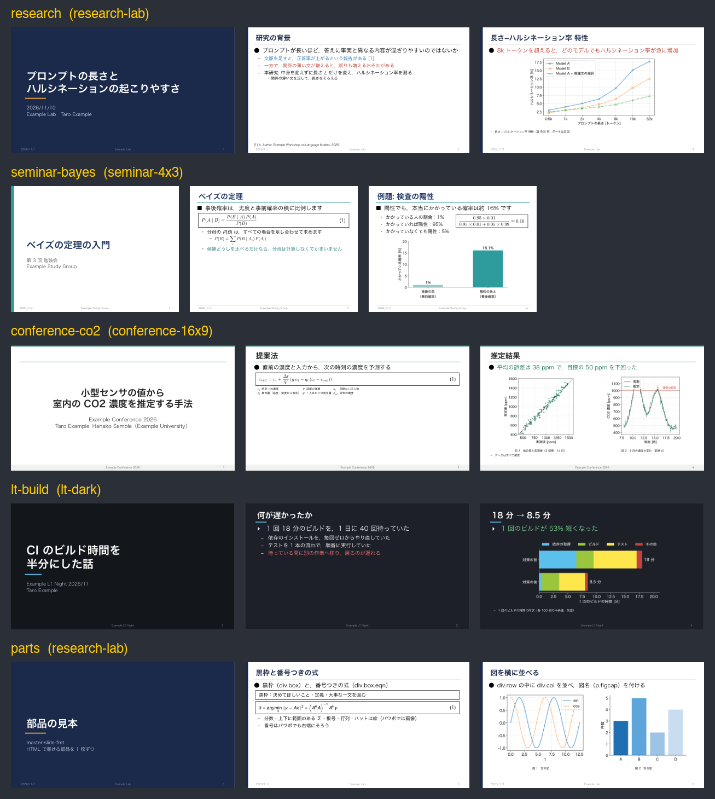
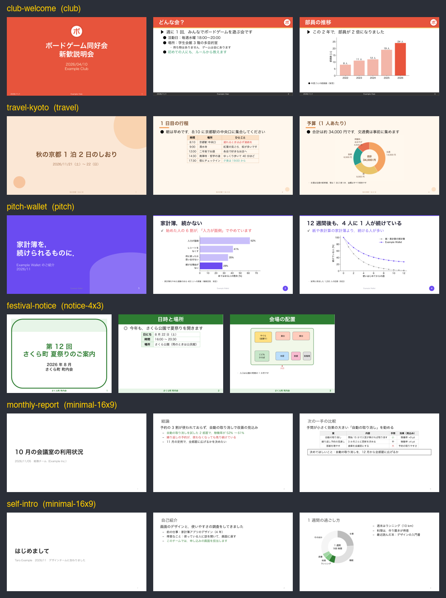
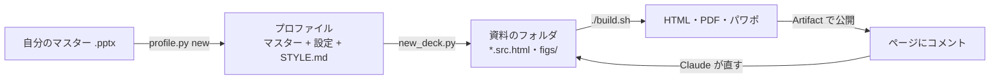

# master-slide-fmt

自分のパワポのマスター（.pptx）を渡すと、その体裁でスライドを作る Claude Code のスキル。

- スライドは縦スクロールの HTML で 1 枚ずつ書く（`*.src.html`。式は `$…$` の LaTeX）
- `./build.sh` で、図と体裁を埋め込んだ HTML、PDF、**全部編集できるパワポ**（渡したマスターの上。文はテキスト、表は表、式はテキストか画像）を作る
- マスターから、スライドの大きさ（4:3 / 16:9）、タイトルの位置・大きさ・色、本文の書体と段、飾り（線・帯・画像）、背景、脚注を読み取る
- 研究室・サークル・会社など、使う形を **プロファイル** で切り替える。作業しているディレクトリから、どれを使うかを選ぶ
- Claude では、HTML を Artifact（claude.ai のページ）で公開し、ページに付いたコメントを読んで直し、公開し直す流れで仕上げる

## 見た目

### HTML のプレビュー

縦にスクロールして 1 枚ずつ見る。右上のボタンで、同じフォルダの PDF とパワポを開ける。飾り・脚注・本文の領域は build のときに HTML へ書き込むので、スクリプトが動かない表示でも崩れない。



### PDF とパワポ

PDF は 1 枚 1 ページ。パワポは渡したマスターの上に置き直してあり、文・表・式を編集できる（下の画像は LibreOffice で表示したもの。PowerPoint では日本語の字間が少し違う）。

| PDF | パワポ |
|---|---|
|  |  |

### 同じ資料を、プロファイルごとに

同じ src を、4 つの見本のプロファイルで作った（表紙・2 枚目・4 枚目）。大きさ・見出しの位置と色・記号・飾り・背景・脚注が、それぞれのマスターと設定から入る。



## 見本

テーマ・数値・文献・名前は、すべて架空。

### プロファイル（`examples/`）

| プロファイル | 大きさ | 用途 | 形 |
|---|---|---|---|
| `research-lab` | 16:9 | 研究室のゼミ・報告 | 左端に紺の縦の帯、左寄せの見出しの下に細い線、表紙は紺の背景。記号は ● – ・ |
| `seminar-4x3` | 4:3 | 勉強会・講義 | 白地に左寄せの紺の見出しと色の線、表紙は左端に色の縦の帯。記号は ■ ・ – |
| `club` | 16:9 | サークル・イベント | 上に色の帯（タイトルは白）、右上にロゴの画像、表紙は色の背景 |
| `lt-dark` | 16:9 | LT・技術発表 | 暗い背景に白い文字、見出しの下に短い水色の線。文字は大きめ |
| `conference-16x9` | 16:9 | 学会・研究会の口頭発表 | 上端に細い緑の帯、下に学会名の入った脚注の帯 |
| `minimal-16x9` | 16:9 | 社内の報告・定例 | 飾りなし、細めの見出し、右下にページ番号だけ。本文は記号なし |
| `travel` | 16:9 | 旅行のしおり・案内 | クリーム色の背景、見出しの下に丸い飾り、表紙に大小の円 |
| `pitch` | 16:9 | 製品の紹介・ピッチ | 白地に大きな見出し、ページ番号は紫の丸の中、表紙は紫の背景に大きな円 |
| `notice-4x3` | 4:3 | 地域のお知らせ・掲示 | 上に緑の帯（見出しは白・中央）、表紙は緑の角丸の枠。文字は大きめ |
| `plain-16x9` | 16:9 | 出発点 | 素の Office テーマ。設定はすべてマスターから読む |

各プロファイルには `STYLE.md`（その形の言い回し・見出し・色の付け方の決まり）がある。Claude は資料を書く前にこれを読む。

### 見本の資料（`examples/decks/`）

**研究・勉強・技術の資料**

| 資料 | プロファイル | 中身 | 見せている部品 |
|---|---|---|---|
| `research` | research-lab | ダミーの研究「プロンプトの長さとハルシネーションの起こりやすさ」 | 本文と内容、番号つきの式、グラフ、表、出典 |
| `seminar-bayes` | seminar-4x3 | 勉強会「ベイズの定理の入門」（4:3） | 用語の表、分数の式、2 段組み |
| `conference-co2` | conference-16x9 | 学会発表「室内の CO2 濃度を推定する手法」 | 記号の表、図を横に並べる、図名 |
| `lt-build` | lt-dark | LT「CI のビルド時間を半分にした話」 | 暗い背景の図と式 |
| `parts` | research-lab | 部品の見本（1 枚に 1 つ） | HTML で書ける部品を全部。src を開くと書き方が分かる |



**それ以外の資料**

| 資料 | プロファイル | 中身 | 見せている部品 |
|---|---|---|---|
| `club-welcome` | club | ボードゲーム同好会の新歓説明会 | グラフ、イベントの表、連絡先の表 |
| `travel-kyoto` | travel | 旅行のしおり「秋の京都 1 泊 2 日」 | 行程の表、持ち物の 2 段組み、予算のドーナツ図 |
| `pitch-wallet` | pitch | 家計簿アプリの紹介（ピッチ） | 困りごとのグラフ、機能の箇条書き、料金の表 |
| `festival-notice` | notice-4x3 | 町内の夏祭りのお知らせ（4:3） | 日時の表、会場の配置図、お願いの黒枠 |
| `monthly-report` | minimal-16x9 | 社内の月次報告「会議室の利用状況」 | 結論の枚、比べる表、決めてほしいことの黒枠 |
| `self-intro` | minimal-16x9 | 新しいチームでの自己紹介 | 図と箇条書きの 2 段組み、連絡先の表 |



全部作り直すときは `examples/decks/build_all.sh`。README の画像は `docs/make_images.py` で作り直せる（見本のプロファイルだけを使う）。

```bash
uv run --with playwright --with pymupdf --with pillow python docs/make_images.py
```

## 入れ方

```bash
git clone https://github.com/<owner>/master-slide-fmt ~/.claude/skills/master-slide-fmt
python3 ~/.claude/skills/master-slide-fmt/tools/doctor.py
```

`doctor.py` が、依存があるか・無いと何が外れるかを表で出す。

| 依存 | 無いとき |
|---|---|
| [uv](https://docs.astral.sh/uv/) | 動かない（必須） |
| Google Chrome / Chromium | HTML だけ作る |
| LaTeX（latex・dvisvgm） | 式は MathJax で表示し、パワポでは画像 |
| LibreOffice か PowerPoint | パワポの確認用の画像が作れない |

## 作業の流れ



Claude Code に「このマスターで、サークルの新歓のスライドを作って」のように頼むと、`SKILL.md` の手順でこの流れを進める。手で動かすときの例（マスターの代わりに見本の `examples/club/master.pptx` を使う）:

**1. マスターからプロファイルを作る。** 置き場は `~/.config/master-slide-fmt/profiles/my-club/`。`--match` に書いたディレクトリで作業すると、このプロファイルが選ばれる。

```bash
S=~/.claude/skills/master-slide-fmt
python3 $S/tools/profile.py new my-club --master $S/examples/club/master.pptx --match '~/club/**' --description 'サークルの説明会'
```

**2. 資料のフォルダを作る。** プロファイルは、フォルダの場所から選ばれる（`--profile` で指定もできる）。

```bash
python3 $S/tools/new_deck.py ~/club/slides/2026-04-10_welcome --title 新歓説明会
```

```
作った: ~/club/slides/2026-04-10_welcome/2026-04-10_welcome.src.html
  プロファイル: my-club（ディレクトリが ~/club/** に当てはまる）
```

**3. src を書く。** スライド 1 枚が `<section class="slide">`。書き方は `examples/decks/parts/parts.src.html` を見る。

```html
<section class="slide">
  <h2>どんな会？</h2>
  <p class="lead">週に 1 回，みんなでボードゲームを遊ぶ会です</p>
  <ul class="body">
    <li>活動日：毎週水曜 18:00〜20:00</li>
    <li><span class="good">初めての人にも，ルールから教えます</span></li>
  </ul>
</section>
```

**4. build する。** HTML・PDF・パワポと、全部の枚を並べた確認用の画像（`.build/*.sheet.png`）ができる。はみ出した枚や、パワポで画像にした式があれば知らせる。

```bash
cd ~/club/slides/2026-04-10_welcome && ./build.sh
```

**5. 公開してコメントで直す（Claude のとき）。** Claude が HTML を Artifact で公開する。ページの枚や図にコメントを付けると、Claude がスレッドを読んで直し、build して全部の枚を確かめ、公開し直して、スレッドに直した内容を返信する。

## プロファイルと公開しない情報

自分のマスターには、名前や所属（フッター・作成者の欄）が入っていることが多い。プロファイルは、どのリポジトリの外にもある `~/.config/master-slide-fmt/profiles/<名前>/` に置くのがおすすめ（スキルの中の `profiles/` に置いてもよい。`.gitignore` で公開から外れる）。

`profile.json` の `private_words` に公開したくない語を書いておくと、`tools/check_public.py` が、公開するファイル（.pptx の中のレイアウトと作成者の欄も）を探して知らせる。フォークして公開する前に回す。

```bash
python3 ~/.claude/skills/master-slide-fmt/tools/check_public.py
```

## Claude 以外のハーネスで使うとき

プロファイル・build・PDF・パワポは、どのハーネスでも動く（`SKILL.md` は Codex などからも読める）。ページにコメントを付けて直す流れは Claude の Artifact の機能を使うので、Claude 専用。他のハーネスでは、build した PDF を見て、チャットで直す所を伝える。

ページの要素を選んでメモを AI に渡す道具（例: [Agentation](https://github.com/popey/agentation)）を組み合わせれば、他のハーネスでも近い流れを作れる可能性がある（未検証）。

## フォルダ

```
SKILL.md            Claude が読む手順（プロファイルの選び方、HTML の書き方、コメントで直す流れ、設定の項目）
tools/              build.sh・build_html.py・export_pptx_editable.py・read_master.py・theme_css.py ほか
template/           new_deck.py が資料のフォルダへ写すひな形
examples/           見本のプロファイル（10 種類）
examples/decks/     見本の資料（11 本）と，図を作る make_figs.py・全部作る build_all.sh
docs/               README の画像と，それを作る make_images.py
profiles/           自分のプロファイルの置き場（中身は公開されない）
```
